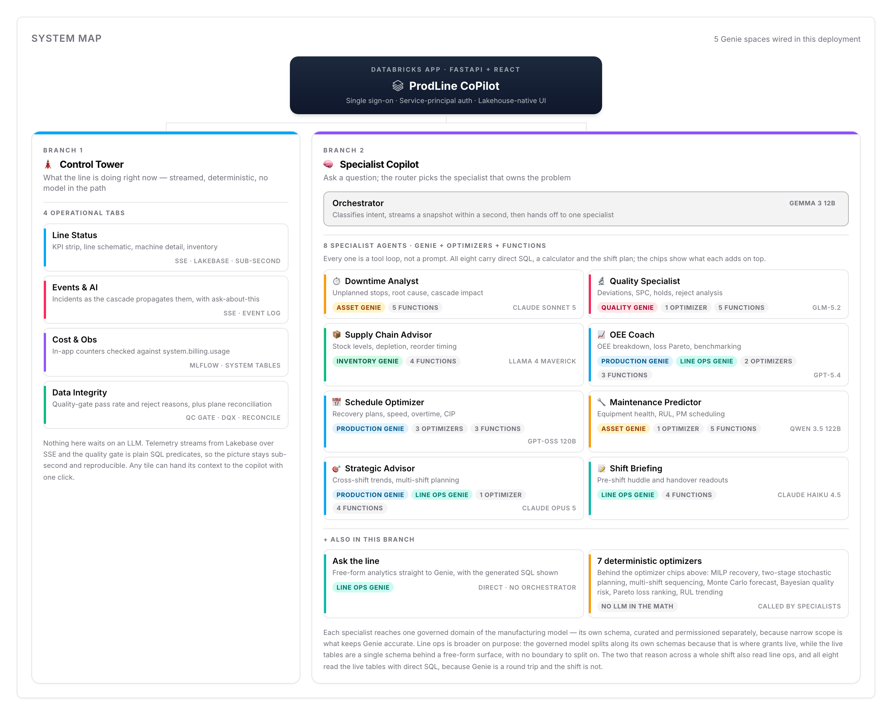

# ProdLine CoPilot: Real-Time Streaming Edition

[](https://databricks.com)
[](https://docs.databricks.com/en/data-governance/unity-catalog/index.html)
[](https://docs.databricks.com/en/compute/serverless.html)

**AI-powered production line management with real-time simulation.** A compound AI system built on Databricks that gives line managers live visibility, cascading fault simulation, and a GenAI assistant for incident resolution.

**See it in 30 seconds:** open [`docs/media/prodline_copilot_film.html`](docs/media/prodline_copilot_film.html) in a browser for a self-contained animated walkthrough of what ProdLine CoPilot looks like in action. (GitHub's in-browser preview won't run the JS, so clone or download the file and open it locally.)

**Deploy in minutes:** fill `config/project-settings.local.yaml`, then run `./scripts/deploy.sh dev` (or `prod`). See [Getting Started](#getting-started) below, or the full runbook in [`docs/solution-accelerator/DEPLOY.md`](docs/solution-accelerator/DEPLOY.md). Architecture and technical reference live in [`docs/ARCHITECTURE.md`](docs/ARCHITECTURE.md).

## What It Does

ProdLine CoPilot simulates a 19-machine bottling/packaging line in real time. An in-process cascade engine models how faults propagate through buffers: when a filler stops, downstream machines gradually starve as buffers drain, and upstream machines block as buffers fill. A GenAI assistant analyzes live telemetry and recommends recovery actions.

**The demo story:** You're a line manager. The line is running normally at ~82 % OEE. You trigger an incident (e.g. filler breakdown). Watch the cascade ripple across the line in real time. Ask the AI assistant what happened, get root-cause analysis and action items, then resolve.

## System Map

One app, two branches. The **Control Tower** is what the line is doing right now — streamed and deterministic, with no model in the path. The **Specialist Copilot** is where you ask a question and a router hands it to the one specialist that owns the problem. Each specialist reaches its own governed Genie space, because narrow scope is what keeps Genie accurate.

<picture>
  <source media="(prefers-color-scheme: dark)" srcset="docs/media/system_map_dark.png">
  
</picture>

Five Genie spaces in all: four over the governed manufacturing model — `asset`, `quality`, `inventory`, `production` — each curated and permissioned separately, plus **line ops** over the live streaming tables where `line_kpi` lands roughly a row per second. The two specialists that reason across a whole shift read line ops as well, and all eight read the live tables with direct SQL, because Genie is a round trip and a shift is not.

Line ops is deliberately the other shape from a governed domain — 14 curated tables against two to four — because the split follows grant boundaries and the live schema has none to follow: it is one schema behind a surface where anyone can ask anything about the current shift.

This is the real component, screenshotted from the app's About tab, where it reads the deployed wiring from `GET /ops/topology` — a domain that did not provision is drawn as SQL-only rather than showing a Genie badge it does not have. Regenerate with `node scripts/dev/capture_system_map.mjs`.

## Architecture

Synthetic line telemetry streams through Zerobus into Unity Catalog, syncs to a Lakebase serving layer, and drives a Databricks App whose GenAI specialists reason over the live state. The full reference — the annotated reference-architecture diagram, cascade engine, tech stack, the 8 specialists, endpoints, and the OEE model — lives in [`docs/ARCHITECTURE.md`](docs/ARCHITECTURE.md).

## Why It Matters

Unplanned downtime and slow incident response are the biggest OEE drains on a packaging line. ProdLine CoPilot targets three levers line managers care about:

- **Faster time-to-resolution (MTTR):** a GenAI assistant reads live telemetry and returns root cause plus ranked recovery actions in seconds, instead of manual trend-hunting across SCADA / MES / CMMS.
- **Fewer cascading losses:** buffer-propagation effects are surfaced early, so operators intervene before a single-machine fault starves or blocks the whole line.
- **Higher, more stable OEE:** continuous OEE / availability / performance visibility (vs. end-of-shift reports) makes every recovered downtime minute and OEE point directly actionable.

Each downtime minute, OEE point, and MTTR reduction carries a line-specific dollar value; plug in your own figures to quantify the return. (This accelerator ships **synthetic** data and asserts no specific ROI numbers.)

## Key Capabilities

- **Real-Time Simulation:** a deterministic cascade engine (in the producer job) with buffer-based propagation streams the live line state.
- **Live KPIs:** OEE, availability, performance, and quality update via SSE (~1 s playback from the Lakebase serving layer) with smooth number transitions.
- **Incident Management:** trigger faults per scenario, watch cascading effects, resolve with one click.
- **Data Source Labels:** every panel shows where data originates (SCADA, MES, SAP, LIMS, CMMS, WMS).
- **GenAI Assistant:** 8 specialist agents analyze live simulation state and recommend actions.
- **Human-in-the-Loop:** each specialist response comes with contextual action chips (a static lookup keyed on specialist name, not LLM-generated) that the operator can approve and act on.
- **Inventory Tracking:** real-time material depletion with time-left estimates and automatic reorder, lead-time, and delivery replenishment (stock recovers on a realistic sawtooth instead of draining to zero).

## Getting Started

### Prerequisites

Provision in your workspace (the bundle does **not** create these): Unity Catalog catalog, SQL warehouse, Lakebase Autoscale endpoint, Zerobus Ingest + endpoint URL, producer service principal + secret, and model serving endpoints. Each agent role runs on a model picked for its workload across six vendors (Anthropic, OpenAI, Google, Meta, Alibaba, Zhipu) on the Foundation Model APIs; any model your workspace doesn't serve falls back to `databricks-gpt-5-mini` / `databricks-gpt-5`, so nothing breaks if you only have some of them. Locally: Databricks CLI, Node.js 22+, `uv`, Python 3.11+. See [`docs/solution-accelerator/DEPLOY.md`](docs/solution-accelerator/DEPLOY.md#1-provision-prerequisites-you-not-created-by-the-bundle) for a step-by-step "what to create" table.

### Deploy

ProdLine CoPilot ships as a **Databricks Asset Bundle** (`databricks.yml`) plus a one-command installer (`scripts/deploy.sh`). `config/project-settings.local.yaml` is the single source of truth; app env vars are auto-derived at deploy time (don't hand-edit `app.yaml`).

```bash
# 1. Fill in your workspace values (host, warehouse, catalog, Lakebase, Zerobus, producer SP)
cp config/project-settings.yaml config/project-settings.local.yaml

# 2. (Optional) validate your config before deploying
python3 scripts/preflight.py dev     # or prod

# 3. Deploy. One command provisions prerequisites, jobs, dashboard, and the App
DATABRICKS_PROFILE=<profile> ./scripts/deploy.sh dev     # -> production-line-copilot-dev
DATABRICKS_PROFILE=<profile> ./scripts/deploy.sh prod    # -> production-line-copilot-prod (type "deploy prod" to confirm)
```

`deploy.sh` is idempotent and self-provisioning:

- **First deploy (fresh workspace):** auto-detects the empty schema and provisions everything: UC schema + tables, reference data, synced tables, the curated **Genie space**, the app service principal (auto-captured + granted), Lakebase roles, and the Data Quality dashboard.
- **Later deploys:** code-only. It pushes new app/job code and skips provisioning.

The `streaming-producer` and `streaming-quality-sync` jobs ship **unpaused**, so live data starts flowing on its own; gold tables and the Data Quality dashboard fill within a few minutes. Then open the deployed **production-line-copilot-dev** App to see the live line and the GenAI assistant. To tear an environment down later, run `scripts/cleanup.sh <dev|prod>`. That
removes the bundle resources, deletes the Genie spaces it created, and resets
the ids `deploy.sh` wrote back into your local settings, so the next deploy
starts clean. Unity Catalog data is kept unless you add `--purge-data`, which
also drops the streaming schema (and with it the streaming checkpoints) and the
governed model's schemas. The UC catalog, Lakebase instance, SQL warehouse, and
secret scopes are prerequisites and are never removed.

**Options:** `RUN_SETUP=1` forces re-provisioning; `RUN_SETUP=0` skips it. `RUN_PREFLIGHT=1` runs preflight checks first. Prod enforces the `main` branch (override `DEPLOY_IGNORE_BRANCH=1`).

**Built-in resilience** (no action needed; the script handles these automatically):

- **Private package mirrors:** if your `npm`/`uv` config points at a corporate registry, `deploy.sh` rewrites `package-lock.json` and `uv.lock` back to public npm/PyPI before upload (the Apps build sandbox can only reach public registries). The committed `.npmrc` also pins public npm so a local `npm install` never re-pollutes the lockfile.
- **Stale deploy lock:** if a previous run was interrupted, the leftover bundle lock is cleared automatically (retries once with `--force-lock`).
- **Flaky app build:** a first-attempt build failure (10-minute start timeout, npm blip, OOM, or a corrupted build cache) is recovered automatically with a `stop -> start -> redeploy` on a fresh build container.

If a deploy still fails after the automatic retry, inspect logs with `databricks apps logs <app-name> --tail-lines 200 --profile <profile>` and re-run `./scripts/deploy.sh`. Full runbook: [`docs/solution-accelerator/DEPLOY.md`](docs/solution-accelerator/DEPLOY.md) and [`config/README.md`](config/README.md).

### Local Development

```bash
npm install
uv sync   # or: pip install -e ".[dev]"

# Start both servers (FastAPI + Express)
npm run dev
```

### UI Controls

| Button              | Action                                                 |
| ------------------- | ------------------------------------------------------ |
| **Start**           | Resume simulation without reset                        |
| **Pause**           | Pause the tick loop                                    |
| **Clean Restart**   | Full reset: clears incidents, resets OEE, starts fresh |

## Tests

Use **Python 3.11+** (project `requires-python >=3.11`). From repo root:

```bash
pip install -e ".[dev]"
pytest tests -q
```

## Documentation

- [`docs/ARCHITECTURE.md`](docs/ARCHITECTURE.md): architecture, cascade engine, tech stack, the 8 GenAI specialists, incident scenarios, project structure, server endpoints, and the OEE model.
- [`docs/solution-accelerator/DEPLOY.md`](docs/solution-accelerator/DEPLOY.md): full deployment runbook (prerequisites, config fields, troubleshooting).
- [`docs/solution-accelerator/GETTING_STARTED.md`](docs/solution-accelerator/GETTING_STARTED.md): deeper getting-started guide.
- [`config/README.md`](config/README.md): configuration reference.

## Maintainers

- **Mohammad Khelghati** ([mohammad.khelghati@databricks.com](mailto:mohammad.khelghati@databricks.com))

For security issues, use the private process in [`SECURITY.md`](SECURITY.md) instead of the address above.

## License

Licensed under the [Apache License 2.0](LICENSE.md). Copyright 2026 Databricks, Inc.
and the ProdLine CoPilot contributors. Contributions are welcome; see
[`CONTRIBUTING.md`](CONTRIBUTING.md).

### Third-Party Package Licenses

The source in this project is provided under the [Apache License 2.0](LICENSE.md).
All included or referenced third-party libraries are subject to their own licenses.
Application and pipeline dependencies are declared in `pyproject.toml` / `uv.lock`
(Python) and `package.json` / `package-lock.json` (Node.js); full attributions are
in [`NOTICE.md`](NOTICE.md).

| Package | License | Notes |
|---------|---------|-------|
| `psycopg2` (PostgreSQL adapter) | LGPL-3.0-only | Used unmodified, imported at runtime as a separately installed package; not statically combined or redistributed in source. |
| All other Python dependencies | MIT / BSD / ISC / Apache-2.0 / PSF | Permissive licenses. |
| All Node.js dependencies | MIT / BSD / ISC / Apache-2.0 | Permissive licenses. |

&copy; 2026 Databricks, Inc. All rights reserved.

## Customizing for your environment

1. Copy `config/project-settings.yaml` to `config/project-settings.local.yaml` (gitignored) and fill **only** that file: workspace host, warehouse, UC catalog/schema, Lakebase endpoints, Zerobus URL, producer SP + secret ref.
2. Leave `app_client_id` as `SET_ME`; deploy auto-captures it from the created Databricks App service principal.
3. Leave `src_catalog` / `src_schema` **empty** to generate reference data in-workspace (recommended). Set both only to copy from an existing seed schema.
4. `app.yaml` / `app.dev.yaml` env values (`UC_CATALOG`, `PGHOST`, `SIM_SHIFT_ID`, etc.) are derived by `scripts/render_app_yaml.py` at deploy time.
5. `${DEPLOYER_EMAIL}` is auto-substituted from `databricks current-user me` (override with `DEPLOYER_EMAIL=...`).
6. Deploy fails fast on any required `SET_ME` placeholder before bundle upload.

## Disclaimer

This project is a **Solution Accelerator** provided **as-is**, for illustrative and
educational purposes. It is not an official Databricks product, is not covered by
Databricks Support, SLAs, or any warranty, and is not intended for production use
without your own review, testing, and hardening.

- All datasets are **synthetic**: no real customer, personal, or proprietary data
  is included. See [`NOTICE.md`](NOTICE.md) for data provenance.
- Third-party libraries are distributed under their own licenses; see
  [`NOTICE.md`](NOTICE.md) for attributions.
- To report a security issue, see [`SECURITY.md`](SECURITY.md).

Use at your own risk. &copy; 2026 Databricks, Inc.
