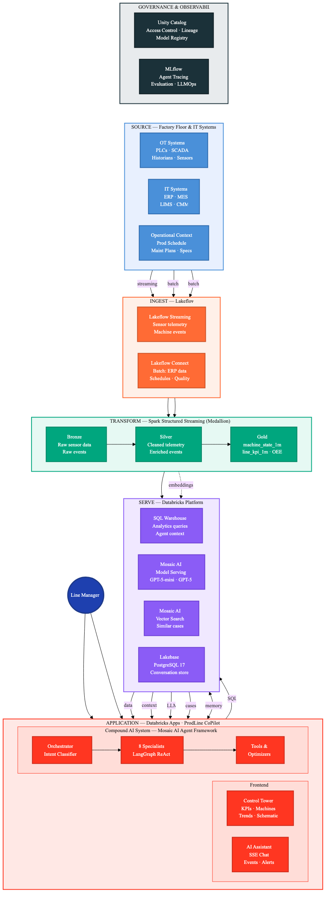

# ProdLine CoPilot — Real-Time Streaming Edition

[](https://databricks.com)
[](https://docs.databricks.com/en/data-governance/unity-catalog/index.html)
[](https://docs.databricks.com/en/compute/serverless.html)

**AI-powered production line management with real-time simulation** — a compound AI system built on Databricks that gives line managers live visibility, cascading fault simulation, and a GenAI assistant for incident resolution.

**▶ See it in 30 seconds:** open [`docs/media/prodline_copilot_film.html`](docs/media/prodline_copilot_film.html) in a browser for a self-contained animated walkthrough of what ProdLine CoPilot looks like in action. (GitHub's in-browser preview won't run the JS — clone or download the file and open it locally.)

**Where to deploy:** all environments use the **Zerobus** streaming path — producer job → Zerobus → Bronze Delta → **`streaming_quality_sync`** → Lakebase **`ai_serving.*`** → App (**`SSE_SOURCE=lakebase`**). Run **`python3 scripts/preflight.py dev`** (or `prod`), fill **`config/project-settings.local.yaml`**, then **`./scripts/deploy.sh dev`** or **`./scripts/deploy.sh prod`**. Start with **[`docs/solution-accelerator/DEPLOY.md`](docs/solution-accelerator/DEPLOY.md)**; deeper runbooks in [`docs/solution-accelerator/GETTING_STARTED.md`](docs/solution-accelerator/GETTING_STARTED.md).

> **Deployment model:** unlike the notebook-driven `RUNME.py` / `_resources`
> blueprint used by some Databricks industry-solutions accelerators, this project
> deploys via **Databricks Asset Bundles** (`databricks bundle` + `scripts/deploy.sh`).
> There is intentionally no `RUNME.py`. The `notebooks/00–05` files are a
> **step-by-step reference mirror** of what `deploy.sh` does (for reading/learning
> in the workspace) — the single **executable** path is `./scripts/deploy.sh`, which
> is idempotent and self-provisioning.

## What It Does

ProdLine CoPilot simulates a 19-machine bottling/packaging line in real time. An in-process cascade engine models how faults propagate through buffers — when a filler stops, downstream machines gradually starve as buffers drain, and upstream machines block as buffers fill. A GenAI assistant analyzes live telemetry and recommends recovery actions.

**The demo story:** You're a line manager. The line is running normally at ~82 % OEE. You trigger an incident (e.g. filler breakdown). Watch the cascade ripple across the line in real time. Ask the AI assistant what happened, get root-cause analysis and action items, then resolve.

## Why It Matters

Unplanned downtime and slow incident response are the biggest OEE drains on a packaging line. ProdLine CoPilot targets three levers line managers care about:

- **Faster time-to-resolution (MTTR)** — a GenAI assistant reads live telemetry and returns root cause plus ranked recovery actions in seconds, instead of manual trend-hunting across SCADA / MES / CMMS.
- **Fewer cascading losses** — buffer-propagation effects are surfaced early, so operators intervene before a single-machine fault starves or blocks the whole line.
- **Higher, more stable OEE** — continuous OEE / availability / performance visibility (vs. end-of-shift reports) makes every recovered downtime minute and OEE point directly actionable.

Each downtime minute, OEE point, and MTTR reduction carries a line-specific dollar value — plug in your own figures to quantify the return. (This accelerator ships **synthetic** data and asserts no specific ROI numbers.)

## Key Capabilities

- **Real-Time Simulation** — a deterministic cascade engine (in the producer job) with buffer-based propagation streams the live line state
- **Live KPIs** — OEE, availability, performance, quality update via SSE (~1 s playback from the Lakebase serving layer) with smooth number transitions
- **Incident Management** — trigger faults per scenario, watch cascading effects, resolve with one click
- **Data Source Labels** — every panel shows where data originates (SCADA, MES, SAP, LIMS, CMMS, WMS)
- **GenAI Assistant** — 8 specialist agents analyze live simulation state and recommend actions
- **Human-in-the-Loop** — each specialist response is accompanied by a set of contextual action chips (static lookup keyed on specialist name, not LLM-generated) that the operator can approve and act on
- **Inventory Tracking** — real-time material depletion with time-left estimates and automatic reorder → lead-time → delivery replenishment (stock recovers on a realistic sawtooth instead of draining to zero)

## Architecture

Aligned with the Databricks reference architecture for Industrial AI, GenAI agents, and Databricks Apps — from factory-floor sources through medallion transform, serving, and the compound-AI application:



<details>
<summary>Text view (application runtime layers)</summary>

```
┌─────────────────────────────────────────────────────────────┐
│  React Frontend (AppKit)                                    │
│  KPIStrip · LineSchematic · EventFeed · InventoryPanel      │
│  IncidentPanel · ChatPanel · ActionPanel                    │
│  ←── SSE (~1 s, Lakebase playback) ──→                     │
├─────────────────────────────────────────────────────────────┤
│  Express Proxy (server.ts)                                  │
│  /api/serving/stream  /api/agent  /api/sim/*                │
├─────────────────────────────────────────────────────────────┤
│  FastAPI Agent Server (start_server.py)                     │
│  ┌───────────────────────────────────────────────────────┐  │
│  │  LangGraph Agent (8 specialists)                      │  │
│  │  context_builder → live state (Lakebase ai_serving.*) │  │
│  │  tools: per-specialist (see below)                   │  │
│  │  memory: Lakebase conversations                      │  │
│  └───────────────────────────────────────────────────────┘  │
│  /serving/stream + /sim/* read/command Lakebase ai_serving.*│
├─────────────────────────────────────────────────────────────┤
│  Producer job (cascade.py · incidents.py · inventory)      │
│  → Zerobus → bronze Delta → streaming_quality_sync         │
│  → Lakebase ai_serving.*  (the sole writer of live state)  │
├─────────────────────────────────────────────────────────────┤
│  Databricks Platform                                        │
│  Unity Catalog · SQL Warehouse · Model Serving · MLflow     │
│  Lakebase · Vector Search · Mosaic AI                       │
└─────────────────────────────────────────────────────────────┘
```

</details>

## How the Cascade Engine Works

The line is a sequence of machines connected by finite buffers. Each tick:

1. **Reset** derived statuses (starved/blocked → running)
2. **Attenuate** effective capacity based on buffer fill levels
3. **Forward pass** — compute production flow per machine
4. **Buffer update** — net in/out per buffer
5. **Status pass** — derive `speed_pct`, detect starved/blocked

When a machine stops, downstream machines keep running while their input buffers have headroom. As buffers drain below 60 %, machines slow proportionally. Recovery reverses the process as buffers refill.

The tick loop is **deterministic** — no randomness in `cascade_tick`. Sensor-level jitter (±1.5 % throughput, ±1.0 speed) is added only in `snapshot_to_dicts` at emission time so the cascade's flow accounting stays exact and unit-testable.

## Tech Stack

| Layer             | Technology                                                                                                        |
| ----------------- | ----------------------------------------------------------------------------------------------------------------- |
| **Frontend**      | React 19, TypeScript, ECharts, Databricks AppKit, SSE                                                             |
| **Proxy**         | Express, Node.js 22, AppKit server plugin                                                                         |
| **Agent Server**  | FastAPI, LangGraph, ChatDatabricks (GPT-5-mini for 6 specialists; full GPT-5 for oee_coach and strategic_advisor) |
| **Simulation**    | Producer job: cascade.py (pure, deterministic) → Zerobus → Lakebase                                               |
| **Data**          | Unity Catalog, Delta Lake, SQL Warehouse                                                                          |
| **Memory**        | Lakebase (PostgreSQL 17) for conversations                                                                        |
| **Observability** | MLflow tracing, agent evaluation                                                                                  |
| **Deployment**    | Databricks Asset Bundles (DABs), Databricks Apps                                                                  |

## GenAI Specialist Agents

The orchestrator (`agent_server/agent.py`) routes each query to one of eight LangGraph ReAct agents. When an incident is active, routing is deterministic (via `INCIDENT_TO_SPECIALIST`). Otherwise an LLM classification call with `max_tokens=50` picks the specialist. All agents use `langgraph.prebuilt.create_react_agent` with a `recursion_limit` of 10.

| Specialist              | Model      | Tools                                                                                                                  |
| ----------------------- | ---------- | ---------------------------------------------------------------------------------------------------------------------- |
| `downtime_analyst`      | GPT-5-mini | sql_query, load_plan_and_constraints, calculator, retrieve_similar_cases, detect_anomalies                             |
| `quality_specialist`    | GPT-5-mini | sql_query, load_plan_and_constraints, calculator, retrieve_similar_cases, detect_anomalies, quality_risk_assessment    |
| `supply_chain_advisor`  | GPT-5-mini | sql_query, load_plan_and_constraints, calculator, retrieve_similar_cases                                               |
| `oee_coach`             | **GPT-5**  | sql_query, genie_query, calculator, load_plan_and_constraints, oee_loss_analysis, production_forecast                  |
| `schedule_optimizer`    | GPT-5-mini | sql_query, load_plan_and_constraints, calculator, schedule_recovery, production_forecast, stochastic_schedule_recovery |
| `maintenance_predictor` | GPT-5-mini | sql_query, load_plan_and_constraints, calculator, retrieve_similar_cases, detect_anomalies, estimate_rul               |
| `strategic_advisor`     | **GPT-5**  | sql_query, genie_query, calculator, load_plan_and_constraints, retrieve_similar_cases, multi_shift_plan                |
| `shift_briefing`        | GPT-5-mini | sql_query, genie_query, calculator, load_plan_and_constraints, retrieve_similar_cases                                  |

Action chips shown alongside each agent response are a static lookup keyed on specialist name (`_extract_actions` in `agent_server/agent.py`) — they are not generated by the LLM.

## Incident Scenarios

The following scenario IDs are recognised by the routing layer (`INCIDENT_TO_SPECIALIST` in `agent_server/agent.py`). Each is deterministically routed to the correct specialist without an LLM classification call.

| Scenario              | Routed to             |
| --------------------- | --------------------- |
| `machine_breakdown`   | downtime_analyst      |
| `sensor_failure`      | downtime_analyst      |
| `safety_incident`     | downtime_analyst      |
| `zone_lockout`        | downtime_analyst      |
| `speed_loss`          | oee_coach             |
| `minor_stops`         | oee_coach             |
| `quality_deviation`   | quality_specialist    |
| `contamination`       | quality_specialist    |
| `material_shortage`   | supply_chain_advisor  |
| `supply_delay`        | supply_chain_advisor  |
| `vibration_anomaly`   | maintenance_predictor |
| `maintenance_overdue` | maintenance_predictor |
| `changeover_delay`    | schedule_optimizer    |
| `rush_order`          | schedule_optimizer    |

## Project Structure

```
├── agent_server/            # FastAPI agent server
│   ├── agent.py             # Orchestrator + streaming
│   ├── start_server.py      # FastAPI app, SSE endpoints, sim control
│   ├── context_builder.py   # Parallel SQL context builder
│   ├── sim/                 # Incident command store (Lakebase) + recovery lookup
│   │   ├── commands.py      # scenario_commands CRUD (ai_serving.*)
│   │   └── recovery.py      # map machine_id → active command_ids
│   ├── hitl/                # Human-in-the-loop action tracking
│   ├── specialists/         # 8 LangGraph ReAct agents
│   ├── prompts/             # Specialist system prompts
│   ├── tools/               # sql_query, calculator, anomaly_detector, and more
│   └── memory/              # Lakebase conversation store
├── src/streaming_sim/       # Core simulation logic
│   ├── cascade.py           # Buffer-based cascade engine (pure)
│   └── incidents.py         # Incident → fault mapping
├── client/                  # React frontend
│   └── src/
│       ├── App.tsx           # Main app, KPI calculation, sim controls
│       ├── components/       # UI panels with data source badges
│       └── lib/              # useSSELiveData, useIncidentApi hooks
├── server/                  # Express proxy (server.ts)
├── config/queries/          # SQL queries for AppKit analytics
├── scripts/                 # Deploy, bootstrap, init scripts
│   └── deploy.sh                 # ./scripts/deploy.sh dev|prod
├── tests/                   # Unit + integration tests
│   └── streaming_sim/       # Cascade and incident tests
├── docs/solution-accelerator/  # Deployment + getting-started guides
├── databricks.yml           # Asset Bundle (includes config/bundle-targets.yaml)
├── app.yaml                 # Prod app env (line_manager_prod)
└── app.dev.yaml             # Dev app env (line_manager_dev) — swapped over app.yaml by deploy.sh
```

## Additional Server Endpoints

Beyond the agent and simulation endpoints, `agent_server/start_server.py` exposes:

- **Ops control plane** (`/ops/cost-summary`, `/ops/cost-live`, `/ops/dashboard-info`, `/ops/control/state`, `/ops/control/action`) — pauses, resumes, and restarts the Databricks producer job and **`streaming_quality_sync`** job; surfaces live token/DBU cost metrics.
- **`/sim/warmup`** — phased startup probe that sequentially checks SQL connectivity, `scenario_commands` table availability, Lakebase health, and engine tick status. Useful for canary validation after a deploy.

## Getting Started

### Installation Guidelines

ProdLine CoPilot ships as a **Databricks Asset Bundle** (`databricks.yml`) plus a one-command installer (`scripts/deploy.sh`). The steps below follow the standard Databricks solution-accelerator flow; **step 3 uses `scripts/deploy.sh`** rather than a bare "Deploy" click, because this accelerator also provisions prerequisites (Unity Catalog schema/tables, Lakebase roles, the Genie space, the Data Quality dashboard) and builds a Databricks App.

**1. Clone this repository into your Databricks Workspace.**


**2. Open the Asset Bundle Editor** in the Databricks UI to review the bundle — the App, streaming/setup jobs, Data Quality dashboard, and MLflow experiment defined in `databricks.yml`.


**3. Configure, then deploy with the one-command installer.** Copy `config/project-settings.yaml` → `config/project-settings.local.yaml`, fill in your workspace values, then from a terminal (Databricks CLI) run:

```bash
DATABRICKS_PROFILE=<profile> ./scripts/deploy.sh dev     # → production-line-copilot-dev
```

`deploy.sh` deploys the bundle **and** provisions everything the app needs (idempotent + self-provisioning). A bare "Deploy" from the Asset Bundle Editor deploys the bundle but skips the prerequisite provisioning — use `deploy.sh` for a working end-to-end install. To tear an environment down later, run `scripts/cleanup.sh <dev|prod>`.


**4. Watch it come alive.** The `streaming-producer` and `streaming-quality-sync` jobs ship **unpaused**, so live data starts flowing on its own — gold tables and the Data Quality dashboard fill within a few minutes. Open the deployed **production-line-copilot-dev** App to see the live line and the GenAI assistant.


> The UI screenshots above are the standard Databricks Asset Bundle experience. For the full step-by-step (prerequisites table, config fields, troubleshooting), see **[`docs/solution-accelerator/DEPLOY.md`](docs/solution-accelerator/DEPLOY.md)**.

### Prerequisites

Provision in your workspace (the bundle does **not** create these): Unity Catalog catalog, SQL warehouse, Lakebase Autoscale endpoint, Zerobus Ingest + endpoint URL, producer service principal + secret, and model serving endpoints (defaults `databricks-gpt-5-mini` + `databricks-gpt-5`; override the names in `project-settings` if your workspace differs). Locally: Databricks CLI, Node.js 22+, `uv`, Python 3.11+. See **[`docs/solution-accelerator/DEPLOY.md`](docs/solution-accelerator/DEPLOY.md#1-provision-prerequisites-you--not-created-by-the-bundle)** for a step-by-step "what to create" table.

Validate before deploy:

```bash
cp config/project-settings.yaml config/project-settings.local.yaml
# …fill required fields…
python3 scripts/preflight.py dev    # or prod
```

### Local Development

```bash
npm install
uv sync   # or: pip install -e ".[dev]"

# Start both servers (FastAPI + Express)
npm run dev
```

### Deploy

Two steps. `config/project-settings.local.yaml` is the single source of truth; app env vars are auto-derived at deploy time (don't hand-edit `app.yaml`).

```bash
# 1. Fill in your workspace values (host, warehouse, catalog, Lakebase, Zerobus, producer SP)
cp config/project-settings.yaml config/project-settings.local.yaml

# 2. Deploy — one command does everything
DATABRICKS_PROFILE=<profile> ./scripts/deploy.sh dev     # → production-line-copilot-dev
DATABRICKS_PROFILE=<profile> ./scripts/deploy.sh prod    # → production-line-copilot-prod (type "deploy prod" to confirm)
```

`deploy.sh` is idempotent and self-provisioning:

- **First deploy (fresh workspace):** auto-detects the empty schema and provisions everything — UC schema + tables, reference data, synced tables, the curated **Genie space**, the app service principal (auto-captured + granted), Lakebase roles, and the Data Quality dashboard.
- **Later deploys:** code-only — pushes new app/job code, skips provisioning.

The `streaming-producer` and `streaming-quality-sync` jobs ship **unpaused**, so live data starts flowing on its own (gold tables + dashboard fill within a few minutes).

**Options:** `RUN_SETUP=1` forces re-provisioning; `RUN_SETUP=0` skips it. `RUN_PREFLIGHT=1` runs preflight checks first. Prod enforces the `main` branch (override `DEPLOY_IGNORE_BRANCH=1`).

**Built-in resilience** (no action needed — the script handles these automatically):

- **Private package mirrors** — if your `npm`/`uv` config points at a corporate registry, `deploy.sh` rewrites `package-lock.json` and `uv.lock` back to public npm/PyPI before upload (the Apps build sandbox can only reach public registries). The committed `.npmrc` also pins public npm so a local `npm install` never re-pollutes the lockfile.
- **Stale deploy lock** — if a previous run was interrupted, the leftover bundle lock is cleared automatically (retries once with `--force-lock`).
- **Flaky app build** — a first-attempt build failure (10-minute start timeout, npm blip, OOM, or a corrupted build cache) is recovered automatically with a `stop → start → redeploy` on a fresh build container.

If a deploy still fails after the automatic retry, inspect logs with `databricks apps logs <app-name> --tail-lines 200 --profile <profile>` and re-run `./scripts/deploy.sh`.

More detail: **`config/README.md`** · **`docs/solution-accelerator/DEPLOY.md`**.

### UI Controls

| Button              | Action                                                  |
| ------------------- | ------------------------------------------------------- |
| **▶ Start**         | Resume simulation without reset                         |
| **⏸ Pause**         | Pause the tick loop                                     |
| **↺ Clean Restart** | Full reset — clears incidents, resets OEE, starts fresh |

## OEE Calculation

OEE uses industry baselines for a top-quartile F&B line:

| Factor          | Baseline  | Rationale                                            |
| --------------- | --------- | ---------------------------------------------------- |
| Availability    | 88 %      | Changeovers ~4 %, CIP ~3 %, planned maintenance ~2 % |
| Performance     | 95 %      | Minor stops ~3 %, reduced speed ~2 %                 |
| Quality         | 98.5 %    | Start-up rejects ~1 %, rework ~0.5 %                 |
| **Healthy OEE** | **~82 %** | Top-quartile benchmark for F&B packaging             |

Incident faults reduce availability and performance in real time; quality is held constant for the demo.

## Tests

Use **Python 3.11+** (project `requires-python >=3.11`). From repo root:

```bash
pip install -e ".[dev]"
pytest tests -q
```

## License

Licensed under the [Apache License 2.0](LICENSE.md). Copyright 2026 Databricks, Inc.
and the ProdLine CoPilot contributors. Contributions are welcome — see
[`CONTRIBUTING.md`](CONTRIBUTING.md).

### 📄 Third-Party Package Licenses

The source in this project is provided under the [Apache License 2.0](LICENSE.md).
All included or referenced third-party libraries are subject to their own licenses.
Application and pipeline dependencies are declared in `pyproject.toml` / `uv.lock`
(Python) and `package.json` / `package-lock.json` (Node.js); full attributions are
in [`NOTICE.md`](NOTICE.md).

| Package | License | Notes |
|---------|---------|-------|
| `psycopg2` (PostgreSQL adapter) | LGPL-3.0-only | Used unmodified, imported at runtime as a separately installed package; not statically combined or redistributed in source. |
| All other Python dependencies | MIT / BSD / ISC / Apache-2.0 / PSF | Permissive licenses. |
| All Node.js dependencies | MIT / BSD / ISC / Apache-2.0 | Permissive licenses. |

&copy; 2026 Databricks, Inc. All rights reserved.

## Customizing for your environment

1. Copy `config/project-settings.yaml` → `config/project-settings.local.yaml` (gitignored) and fill **only** that file — workspace host, warehouse, UC catalog/schema, Lakebase endpoints, Zerobus URL, producer SP + secret ref.
2. Leave `app_client_id` as `SET_ME`; deploy auto-captures it from the created Databricks App service principal.
3. Leave `src_catalog` / `src_schema` **empty** to generate reference data in-workspace (recommended). Set both only to copy from an existing seed schema.
4. `app.yaml` / `app.dev.yaml` env values (`UC_CATALOG`, `PGHOST`, `SIM_SHIFT_ID`, etc.) are derived by `scripts/render_app_yaml.py` at deploy time.
5. `${DEPLOYER_EMAIL}` is auto-substituted from `databricks current-user me` (override with `DEPLOYER_EMAIL=…`).
6. Deploy fails fast on any required `SET_ME` placeholder before bundle upload.

## Disclaimer

This project is a **Solution Accelerator** provided **as-is**, for illustrative and
educational purposes. It is **not** an official Databricks product, is **not**
covered by Databricks Support, SLAs, or any warranty, and is **not** intended for
production use without your own review, testing, and hardening.

- All datasets are **synthetic** — no real customer, personal, or proprietary data
  is included. See [`NOTICE.md`](NOTICE.md) for data provenance.
- Third-party libraries are distributed under their own licenses; see
  [`NOTICE.md`](NOTICE.md) for attributions.
- To report a security issue, see [`SECURITY.md`](SECURITY.md).

Use at your own risk. &copy; 2026 Databricks, Inc.
