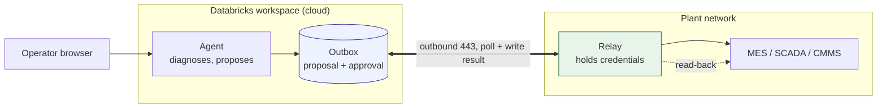
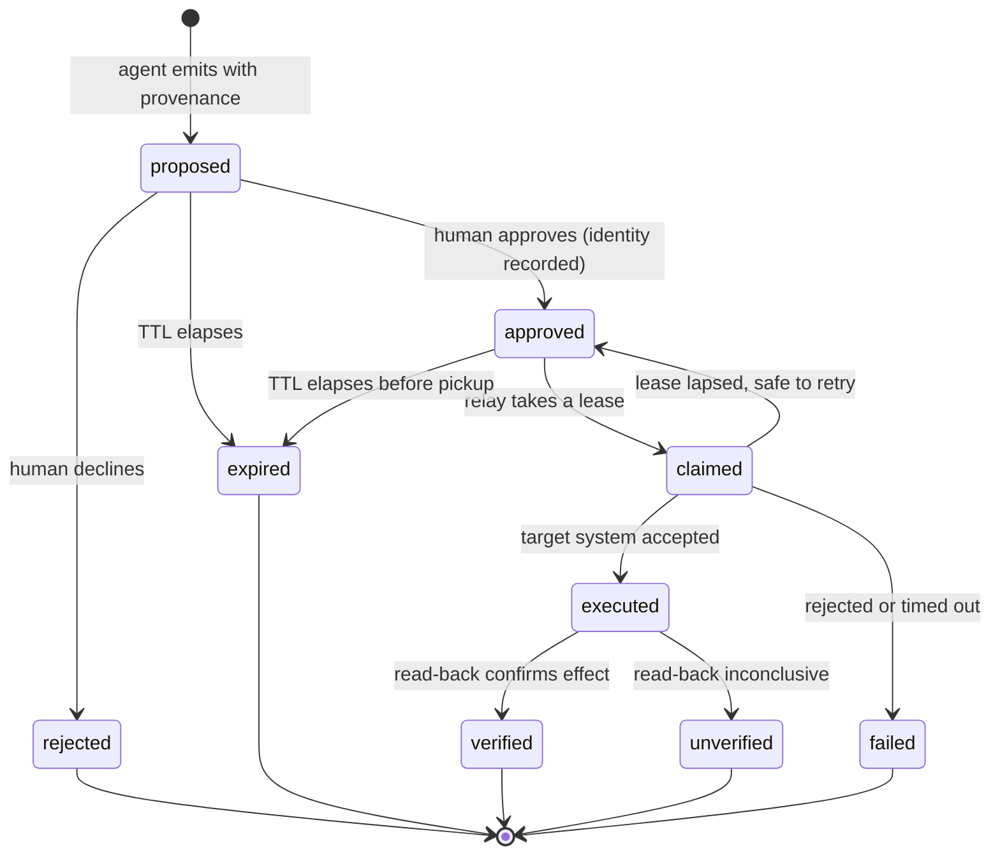

# Writing back to plant systems

Status: design, nothing implemented. Written because "can it actually *do*
anything?" is the first question every operations audience asks, and the honest
answer today is no — the agent diagnoses and proposes, and a human retypes the
result into another system.

## The principle

**A write is an artifact, not an action.** The agent emits a proposed command
with its provenance attached. A separate, small, auditable connector is the only
component holding credentials to the target system, and it validates every
command against its own allowlist rather than trusting what it was handed. The
LLM never touches the connector, never holds a credential, and cannot invent an
action the connector does not already implement.

This is not caution for its own sake. A model that can be argued into a tool
call is a model that can be argued into a setpoint change, and the blast radius
of a bad setpoint on a running line is measured in scrapped product, damaged
equipment, or someone getting hurt. Keeping the actuator dumb and the reasoner
credential-free means a prompt injection costs you a bad *suggestion*, which a
human then declines.

## What already exists

Two of the three pieces are in place, which is why this is worth writing down
now rather than treating it as greenfield.

`_extract_actions()` in `agent_server/agent.py` emits the human-in-the-loop
action chips, and they are deliberately **not** LLM-generated — a static lookup
keyed on specialist plus the active incident's target machine. Each chip already
names the system it would act on (`CMMS / SAP PM`, `SAP MM`, `Workforce Mgmt`).
That determinism is exactly what a proposal needs: the same incident always
yields the same action set, so an approval means something specific.

`/ops/control/action` in `agent_server/start_server.py` already implements the
control-plane discipline, against demo infrastructure rather than plant systems:
caller identity, a role check (`admin`/`operator`), a required `confirm` flag,
an allowlisted target and action, and a cooldown guard. The shape is right and
it is the precedent to follow.

What is missing is the middle — a durable proposal record — and the far side —
something inside the plant network to consume it.

## Topology

The deciding constraint is that the app is a Databricks App running in the
workspace. Its server-side egress originates in the cloud, not inside the plant.
The only thing already inside the customer's network is the operator's browser.

The arrow that matters is the thick one, and its direction is the whole design.
The relay polls *outward* over ordinary HTTPS. No inbound firewall rule, no DMZ
hole, no exception request to the OT security team. That is a political
constraint far more than a technical one, and it is what usually kills these
projects.

Two alternatives were considered and rejected.

**Browser-mediated** — the chip's button calls a local endpoint from the
operator's machine. Attractive because it needs no new infrastructure, and
`http://localhost` is exempt from mixed-content blocking. But an HTTPS page
calling `http://192.168.x.x` is blocked outright, and Chrome's private-network
access checks add preflight requirements, so in practice it needs a helper
installed on every laptop with TLS or a localhost listener. That trades a single
server deployment for fleet software management, and makes the audit trail
depend on a browser tab staying open.

**Direct cloud-to-plant API** — requires inbound access to OT. Expect refusal,
and do not spend the political capital asking.

## The state machine

The transport is the easy part. The states are where correctness lives.

Each transition earns its place:

- **A claim lease** stops two relay instances actuating the same command twice.
  A lapsed lease returns the command to `approved` rather than stranding it.
- **An idempotency key** makes retries safe. Networks fail after the write lands
  as readily as before it, and "did that go through?" must not be answered by
  trying again.
- **A TTL** expires an approval that sat overnight. An approval is consent given
  in a context — line state, shift, product — and that context does not survive
  eight hours. Actuating a stale approval into a different shift is its own
  incident.
- **A read-back** is the difference between "the API returned 200" and "the
  setpoint changed". `executed` is a claim about a request; `verified` is a claim
  about the world. Only the second is worth reporting to an operator.

## The relay contract

The relay is deliberately small and deliberately boring. It should be readable
in one sitting by whoever's signature is on the OT change request.

- Holds the only credentials to the target system.
- Implements a fixed, enumerated set of commands. A proposal naming anything
  else is rejected, logged, and never forwarded — the allowlist lives in the
  relay, not in the payload, so the cloud side cannot widen it.
- Validates every field against a schema and against safety bounds that are
  configured locally, not supplied by the caller.
- Polls outward, writes results back with the same idempotency key.
- Refuses to act on a proposal lacking an approval identity, or past its TTL.

Anything requiring judgement stays on the cloud side. Anything requiring a
credential stays in the relay. The interface between them is a row.

## Sequencing

The temptation is to build the relay first because it is the interesting part.
It should be built last.

1. **Systems of record, not OT.** The existing chips already point at CMMS,
   SAP PM, SAP MM and workforce management. These are IT systems with
   cloud-reachable APIs and their own approval governance, and they are how
   humans actually actuate change today. A work order raised from a diagnosed
   stoppage captures most of the value with no relay and no OT risk.
2. **The artifact.** For genuine setpoint changes, emit a pre-filled change
   sheet with the provenance attached and let the operator apply it. Zero
   integration, and the human remains the actuator — which is what safety review
   will insist on regardless.
3. **The relay, for one action.** Build it when a specific action proves both
   high-volume and repetitive enough to justify it. One command end to end, not
   a general-purpose gateway. A gateway is what you get after the third command,
   if you are lucky.

Steps 1 and 2 need no new infrastructure and exercise the proposal-plus-
provenance design end to end, which is what you want validated before anyone
writes a connector.

## Deliberately undecided

- **Where the outbox lives.** Lakebase already serves the UI's live reads and
  would give the relay low-latency polling; a Delta table would give governance
  and history for free. Not worth deciding before there is a first command.
- **Two-person approval.** Certainly required for anything touching a setpoint,
  plausibly overkill for raising a work order. The threshold is a customer
  policy question, not an architectural one, so the record should carry a list
  of approvals rather than a single approver.
- **What the operator sees on failure.** `failed` and `unverified` are very
  different for a human, and conflating them in the UI would undo the care taken
  to separate them in the model.
