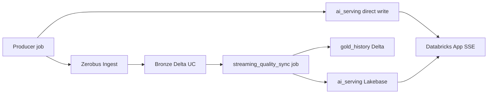

# Zerobus deployment (Solution Accelerator)

One codebase, **one streaming data path**:

**Producer → Zerobus → Bronze Delta → `streaming_quality_sync` → Lakebase `ai_serving.*` → App (`SSE_SOURCE=lakebase`)**

---

## Architecture

| Layer            | What runs                                                             | Where data lands                                                                                                          |
| ---------------- | --------------------------------------------------------------------- | ------------------------------------------------------------------------------------------------------------------------- |
| **Producer**     | Continuous job: `src/streaming_sim/producer.py` (cascade + scenarios) | **Zerobus** → **Bronze Delta** (`*_bronze` tables); optional direct write to **`ai_serving.*`** for sub-second UI latency |
| **Quality sync** | Continuous job: `pipelines/streaming_quality_sync.py`                 | Validated rows → **`gold_history`** Delta + **`ai_serving.*_history`** / **`*_latest`** in Lakebase                       |
| **App SSE**      | `/serving/stream` with **`SSE_SOURCE=lakebase`**                      | Reads **`ai_serving.*_history`** in Postgres                                                                              |

**Incident control** (`agent_server/sim/commands.py`) writes trigger/resolve rows to Lakebase `ai_serving.scenario_commands`; the producer job polls them and applies the fault. There is no in-app simulation engine, the producer is the sole writer of live telemetry.

Optional **Synced Tables** (UC Gold → Lakebase `public.*`) are for SQL tools and Tier-2 consumers, not the Tier-1 SSE read path.



---

## Workspace profiles

| Profile                 | Bundle target       | Deploy                     |
| ----------------------- | ------------------- | -------------------------- |
| **`line_manager_dev`**  | `line_manager_dev`  | `./scripts/deploy.sh dev`  |
| **`line_manager_prod`** | `line_manager_prod` | `./scripts/deploy.sh prod` |

`deploy.sh` supports **only** `dev` and `prod`. Override CLI auth with `DATABRICKS_PROFILE` (default `DEFAULT`).

---

## Deploy steps

### 1. Provision prerequisites (you, not created by the bundle)

`deploy.sh` **auto-creates** the UC schema + tables, reference data, the Databricks
App + its service principal, the jobs, the Data Quality dashboard, and the Genie
space. It **cannot** create the platform resources below, they need workspace
enablement, quota, or admin rights. Provision these once, then record the value
in the config field noted in **[bold]**.

| #   | Bring                                      | How to create                                                                                                                                                                                                                                                                                                            | Config field                                                               |
| --- | ------------------------------------------ | ------------------------------------------------------------------------------------------------------------------------------------------------------------------------------------------------------------------------------------------------------------------------------------------------------------------------ | -------------------------------------------------------------------------- |
| 1   | **SQL warehouse** (serverless recommended) | SQL → **Warehouses** → _Create_. Open it → **Connection details**; the ID is the last path segment of the HTTP path (`/sql/1.0/warehouses/<id>`).                                                                                                                                                                        | `sql_warehouse_id`                                                         |
| 2   | **Unity Catalog catalog** you can write to | **Catalog** → _Create catalog_ (or reuse one you own). The **schema** is created for you by the setup job.                                                                                                                                                                                                               | `uc_catalog` (`uc_schema` has a default)                                   |
| 3   | **Lakebase (Autoscale) database**          | Compute → **Database instances** → create a Postgres instance/project + `production` branch. Copy the **PG host** and build the endpoint path `projects/<project>/branches/production/endpoints/primary`.                                                                                                                | `lakebase_pg_host`, `lakebase_endpoint`                                    |
| 4   | **Zerobus Ingest** entitlement             | Not created here, it's an **ingest entitlement** (account / preview-level). You can't script "enable Zerobus"; confirm it's enabled with your admin. The **endpoint URL is derivable** from workspace-id + region: `https://<workspace-id>.zerobus.<region>.cloud.databricks.com` (the provisioner derives it for you). | `zerobus_server_endpoint`                                                  |
| 5   | **Producer service principal + secret**    | Settings → **Identity and access** → _Service principals_ → create one; generate an **OAuth secret**. Put the secret in a scope: `databricks secrets create-scope line-manager` then `databricks secrets put-secret line-manager zerobus-client-secret`.                                                                 | `producer_client_id`, `producer_client_secret_ref`                         |
| 6   | **Model serving endpoints**                | Usually already present as the pay-per-token **Foundation Model APIs**. Each agent role prefers a vendor-specific model (Anthropic / OpenAI / Google / Meta / Alibaba / Zhipu); anything your workspace doesn't serve falls back to the two tier endpoints below, so partial coverage is fine. Preflight WARNs and names the roles that will degrade. Only override the tiers if your workspace serves `databricks-gpt-5-mini` / `databricks-gpt-5` under different names.  | `model_specialist_endpoint`, `model_advanced_endpoint` (defaults provided) |

**Local tooling:** Databricks CLI, Node.js 22+, `uv`, project deps (`uv sync`).

> `app_client_id` / `lakebase_pg_user` are **auto-captured** from the app service
> principal on the first deploy, leave them `SET_ME`.

#### Optional: auto-provision the creatable prerequisites

If you have the rights (warehouse/SP creation, and, for Lakebase, Postgres
provisioning), `scripts/provision_prereqs.py` creates rows **1, 3, 5** above and
**derives the endpoint URL for 4**, then writes the IDs into
`project-settings.local.yaml`. It **cannot** create the UC catalog (2, usually
governed). It does **not** enable Zerobus (4), that's an ingest entitlement
(account / preview-level) you can't script; the provisioner only derives its
endpoint URL from workspace-id + region. Model endpoints (6) are checked by
preflight, not created.

```bash
python3 scripts/provision_prereqs.py dev                     # dry run, prints what it would do
python3 scripts/provision_prereqs.py dev --apply             # warehouse + producer SP/secret + Zerobus URL
python3 scripts/provision_prereqs.py dev --apply --with-lakebase   # also the (BILLABLE) Lakebase project
```

It is **idempotent** (existing resources matched by name are reused) and defaults to
a dry run. `--with-lakebase` provisions billable compute that bills until deleted.

### 2. Preflight (run first)

```bash
cp config/project-settings.yaml config/project-settings.local.yaml
# …fill required fields in project-settings.local.yaml…

python3 scripts/preflight.py dev    # or prod
```

`scripts/preflight.py` validates CLI auth, required config, warehouse, UC catalog, serving endpoints, secret scope, Lakebase fields, Node, `uv`, and `psycopg2`. Fix any **FAIL** before deploying.

To see the model side on its own — which vendor answers for which agent role, and whether this workspace serves it:

```bash
python3 scripts/preflight.py dev --models
```

The same table prints on every `deploy.sh` run. It never fails a deploy: a role whose preferred model is missing falls back to the tier endpoints. Pin different choices with the `model_roles` map in project-settings.

### 3. Config: `config/project-settings.local.yaml` only

Required per profile (see [`config/README.md`](../../config/README.md)):

- `workspace_host`, `sql_warehouse_id`, `uc_catalog`, `uc_schema`
- `producer_client_id`, `producer_client_secret_ref`, `zerobus_server_endpoint`
- `lakebase_pg_host`, `lakebase_endpoint`

**Do not** hand-edit `app.yaml` / `app.dev.yaml` for UC or Lakebase values, `deploy.sh` derives them via `scripts/render_app_yaml.py`.

- **`app_client_id`**: leave `SET_ME`; auto-captured after the first bundle deploy creates the app service principal.
- **`src_catalog` / `src_schema`**: leave **empty** to generate reference data in-workspace (recommended). Set both only to copy from an existing seed schema.

### 4. Deploy (one command)

```bash
./scripts/deploy.sh dev    # or prod
```

High-level flow inside `deploy.sh`:

1. Sync `project-settings` → `bundle-targets.yaml` + render dashboard placeholders
2. Fail-fast **SET_ME** guard on required fields
3. **Render** app env from `project-settings` (`render_app_yaml.py`)
4. **Bundle deploy**: creates jobs, Data Quality dashboard, Databricks App (+ its SP)
5. **Auto-capture** app SP → write `app_client_id` to `project-settings.local.yaml`
6. **Register** App + Producer SPs as Lakebase Postgres roles (`init_lakebase_role.py`)
7. **Refresh** `OPS_*` IDs into app env (`refresh_app_yaml_ids.py`)
8. **Re-deploy bundle** only if SP or IDs changed on the first pass
9. **`databricks apps deploy`**
10. **Grant + publish** Data Quality dashboard (`grant_app_jobs_view.sh`)
11. **Fresh-env auto-provision**: if the schema is empty, run the setup job **and** create the curated Genie space (app SP granted `CAN_RUN`, id written back), then rewire + redeploy the app

Optional: `RUN_PREFLIGHT=1 ./scripts/deploy.sh dev` runs preflight first; `RUN_EVAL_GATE=1` runs the MLflow eval gate.

Branch guard: **prod** requires `main` (override `DEPLOY_IGNORE_BRANCH=1`); **dev** warns if not on `dev` but does not block forks without a `dev` branch.

### 4b. Alternative: guided notebook path (in-workspace)

`scripts/deploy.sh` is the primary, one-command path. If you prefer to provision from inside the workspace (for a workshop or a serverless-only environment without a laptop), the `notebooks/` folder walks through the same underlying scripts step by step. Import the repo as a **Git folder** (or Workspace Files) and run, in order:

| Notebook | Does |
| --- | --- |
| `00_Parameters` | Widgets for catalog/schema/warehouse/Lakebase/source; discovers the repo root. Every other notebook `%run`s this first. |
| `01_Setup_Unity_Catalog` | Creates the streaming schema + CDF tables (`scripts/init_realtime_uc.py`). |
| `02_Setup_Lakebase_and_Synced_Tables` | Optional: Lakebase app tables + Continuous Synced Tables (needs `lakebase_catalog`). |
| `03_Bootstrap_Demo_Data` | Reference data. Default (empty `src_catalog`/`src_schema`) generates synthetic data in-workspace; set both to COPY from a source schema instead. |
| `04_Deploy_App` | The app itself deploys via the Asset Bundle. Run `./scripts/deploy.sh dev` (or `databricks bundle deploy` + `databricks apps deploy`) from a terminal/CI. Databricks Apps are not deployed from a notebook. |
| `05_Validate` | Row-count checks on the streaming tables + an app smoke checklist. |
| `06_Install_Industry_Data_Model` | Optional: installs the governed Manufacturing model (schemas + tables + metric views) via `scripts/install_industry_data_model.py`. Only needed if you want the governed layer and the reconciliation panel on the Data Integrity tab. |
| `07_Populate_Silver_Model` | Optional: seeds the governed dimensions from reference data. The fact tables are then kept current continuously by the streaming job, not by re-running this. |

Each script-running notebook installs its Python dependencies with `%pip` and locates `scripts/` via `REPO_ROOT`, so it runs regardless of the notebook's working directory. The one step that stays on the CLI is the **app deploy** (04); everything else (data + UC + Lakebase) runs in-notebook. The bundle's `line-manager-solution-accelerator-setup` job runs these same data steps automatically during `deploy.sh`, so you only need the notebooks if you want the guided, step-by-step flow.

Notebooks 06 and 07 are the governed-model steps. `deploy.sh` runs them for you when `mvm_silver_enabled: true`; skip them entirely if you only want the real-time path.

### 5. Data init is automatic; confirm streaming jobs

On a fresh workspace, step 11 above runs the setup job for you (auto-detected). Force with `RUN_SETUP=1 ./scripts/deploy.sh dev` or skip with `RUN_SETUP=0`.

Job display name: **`line-manager-solution-accelerator-setup`**. Tasks: `init_uc` (schema + tables + `inventory_status` view + SP grants) → `bootstrap_reference`; `setup_synced_tables` runs only when `lakebase_catalog` is set.

After deploy, confirm these **continuous** jobs are **RUNNING** (bundle ships them **UNPAUSED**):

| Job                                       | Purpose                                              |
| ----------------------------------------- | ---------------------------------------------------- |
| **`line-manager-streaming-producer`**     | Zerobus ingest + live telemetry                      |
| **`line-manager-streaming-quality-sync`** | Bronze QC → Lakebase `ai_serving.*` + `gold_history` |

See **[`GETTING_STARTED.md`](./GETTING_STARTED.md)** for KPI migrations, app rebuild notes, and validation.

---

## Quick command reference

| Intent                                 | Command                                           |
| -------------------------------------- | ------------------------------------------------- |
| Preflight                              | `python3 scripts/preflight.py dev`                |
| Dev deploy                             | `./scripts/deploy.sh dev`                         |
| Prod deploy                            | `./scripts/deploy.sh prod`                        |
| Force re-provision (UC + seed + Genie) | `RUN_SETUP=1 ./scripts/deploy.sh dev`             |
| CI drift check                         | `python scripts/sync_project_settings.py --check` |

---

## Packaging for distribution (maintainers)

Real workspace identifiers live **only** in gitignored files (`.env`,
`.databricks/`, `config/*.local.yaml`, `config/bundle-targets.yaml`,
`app.*.local.yaml`), so publishing over **git** never leaks them. But zipping the
**working directory** (`zip -r … .`) sweeps those untracked files into the
tarball.

Always package with `git archive` (tracked files only), e.g.:

```bash
./scripts/package_accelerator.sh          # → build/production-line-copilot-<sha>.tar.gz
```

The script exports a committed ref and runs a leak guard that aborts if any
sensitive path slipped in. Never distribute a copy of the live working tree.

---

## Troubleshooting: `relation "public.machine_state" does not exist`

That message means something is querying **Synced Table mirrors** in Postgres (`public.machine_state`, …) but those tables **are not in the Lakebase database** the app connects to.

**Tier-1 SSE** reads **`ai_serving.*_history`** only (`SSE_SOURCE=lakebase`). This error usually comes from helpers or env that force **`LAKEBASE_SYNCED_DATA_SCHEMA=public`** before Synced Tables exist.

### Fix A: Stop querying `public` (fastest)

1. Open **Compute → Apps → your app → Environment variables**.
2. **Delete** **`LAKEBASE_SYNCED_DATA_SCHEMA`** (or leave empty).
3. **Redeploy** (`./scripts/deploy.sh dev` or `prod`).
4. Confirm **`SSE_SOURCE=lakebase`**.

### Fix B: Create `public.machine_state` (full Gold → Lakebase mirror)

1. Set **`lakebase_catalog`** in `project-settings.local.yaml`.
2. Redeploy, then re-run **`line-manager-solution-accelerator-setup`**.
3. Verify tables in Postgres: **`public.machine_state`**, **`public.line_kpi`**, …
4. Set **`LAKEBASE_SYNCED_DATA_SCHEMA=public`** on the app and redeploy.

### Fix C: No rows on the live ribbon

If **`ai_serving.*_history`** is empty but bronze is fresh, check that **`line-manager-streaming-quality-sync`** and the **producer** job are both **RUNNING** (restart them from the Jobs UI if stopped).

---

## UC cleanup

Retiring old catalogs/schemas is **manual** only, see **`UC_CLEANUP_RUNBOOK.md`**.
